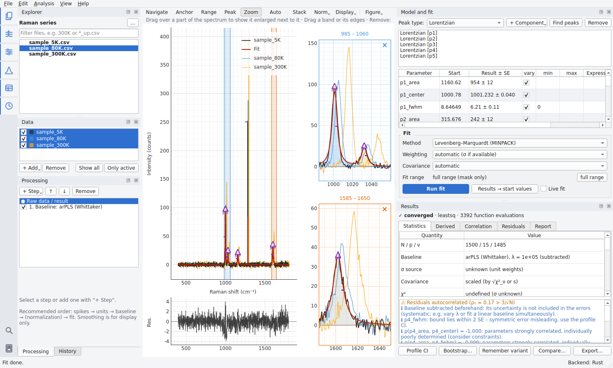

# EZSpec

Interactive spectrum analysis and curve fitting with honest fit statistics.
Rust core for the numerics, Python (lmfit/SciPy) as the statistical reference,
Qt user interface (PySide6 + pyqtgraph), publication figures with matplotlib.



## What EZSpec does differently from Origin/SciDAVis

| Topic | EZSpec |
|---|---|
| Processing | Non-destructive, versioned pipeline. Raw data stay unchanged, every step is a scriptable operation with JSON parameters, everything can be undone. |
| Baselines | Anchor points in the plot (median window/"snap", PCHIP/Akima/cubic/linear), AsLS and arPLS with drawn exclusion and forced ranges, SNIP, rubberband, polynomial (also modpoly/imodpoly). Live preview of the corrected spectrum. Baselines are stored as a recipe, not as an array. |
| Fit statistics | The σ source is mandatory. χ² is only reported for known σ, together with its expected band 1 ± √(2/ν). For known σ the covariance is absolute; scaling with √χ²_ν is possible but flagged. R² is labelled as descriptive. AIC/AICc/BIC are computed in the form that matches the σ source. |
| Diagnostics | Parameters at a bound, \|ρ\| > 0.9, condition number of the Jacobian, runs test, lag-1 autocorrelation, normality measures, QQ plot. Warnings for fits to smoothed, interpolated or normalized data and for Neyman weighting σ = √y. |
| Uncertainties | Full error propagation for derived quantities (height, exact Voigt FWHM, area, area fractions). In addition profile-likelihood CIs, residual and wild bootstrap, MCMC posterior (emcee, optional) and the systematic baseline uncertainty from varying λ. |
| Models | Area-normalized peaks (Gaussian, Lorentzian, exact Voigt, pseudo-Voigt, TCH, Pearson VII, EMG), linear backgrounds fitted together with the peaks, classic functions and custom formulas with any number of parameters and independent variables. Constraints such as `p2_fwhm = p1_fwhm`. |
| Series | Series fits with propagation of start values, global fits with shared parameters, parameter-vs-index plot. |
| Combining datasets | New datasets from formulas of several measurement series, e.g. y = a/b or x = a/b, y = c. The alignment is detected automatically (identical grid, point by point for simultaneous acquisition, or interpolation with a warning). σ is propagated, also for quantities used more than once. If the new x depends on measured values, σ_x is carried along, the fit warns, and the "effective variance" weighting takes σ_x into account. |
| Back-and-forth measurements | The acquisition order is kept, so ramps that run up and down (e.g. a TDLAS current ramp) are drawn as separate sweeps. Up and down sweeps can be selected or averaged separately (σ from the scatter of the repeats). |
| Calibration surfaces | Polynomial surfaces y(x, v) (e.g. a laser's wavelength λ(I, T)), slice display per value of v, and use of the fitted surface as an x-axis calibration of other datasets with a systematic calibration uncertainty and extrapolation checks. |
| Reproducibility | Single-file project (zip) with byte-exact raw data. The script export reproduces pipeline, fit and figure bit for bit from the raw data, checked via SHA-256. |
| Figures | Declarative figure spec (JSON) and matplotlib renderer with journal templates in mm/pt, preview at physical size, secondary x axis (nm ↔ eV ↔ cm⁻¹), parameter box, Petroff colour cycle, editable text in PDF. |

## Installation

Requirements: Python ≥ 3.10 and Rust ≥ 1.83 (`cargo`, `rustc`) for building the native core.

### As a program (Debian 13 / Ubuntu 24.04 and newer)

Installs EZSpec into its own isolated environment and puts the `ezspec` command on the PATH:

```bash
sudo apt install git pipx python3-venv build-essential cargo rustc \
    libegl1 libgl1 libxkbcommon-x11-0 libxcb-cursor0 libxcb-icccm4 libxcb-keysyms1 \
    libxcb-shape0 libxcb-xinerama0 libxcb-randr0 libxcb-render-util0 libxcb-image0 \
    libdbus-1-3 libfontconfig1
rustc --version                   # must be ≥ 1.83 (Debian 13: 1.85); otherwise install Rust via rustup
git clone -b claude/trusting-einstein-647nt6 https://github.com/joreitz/EZSpec.git
pipx install "./EZSpec[gui,mcmc]"  # builds the Rust core (about 1–2 min) and installs all dependencies
pipx ensurepath                   # once; fish: fish_add_path ~/.local/bin
ezspec                            # start (new terminal); a file or .ezspec project can be passed as argument
```

The `lib…` packages are the system libraries the Qt wheels need (X11/xcb and Wayland); on a normal
desktop most of them are already installed. Without `libxcb-cursor0` Qt fails with “could not load
the Qt platform plugin xcb”.

Update: `cd EZSpec && git pull && pipx install --force ".[gui,mcmc]"`. Remove: `pipx uninstall ezspec`.

Menu entry (optional), e.g. `~/.local/share/applications/ezspec.desktop`:

```ini
[Desktop Entry]
Type=Application
Name=EZSpec
Comment=Spectrum analysis and curve fitting
Exec=ezspec %F
Icon=applications-science
Terminal=false
Categories=Science;Education;
```

(If the menu does not find `ezspec`, write the full path, e.g. `Exec=/home/<user>/.local/bin/ezspec %F`.)

### For development

```bash
python3 -m venv .venv && source .venv/bin/activate   # fish: source .venv/bin/activate.fish
pip install -e ".[gui,mcmc,test]"  # builds the Rust extension ezspec._core via maturin
ezspec                            # starts the GUI (alternatively: python -m ezspec)
```

After changes to the Rust code, run `pip install -e .` again. Without the compiled core everything runs
on the NumPy/SciPy reference implementation (`EZSPEC_BACKEND=python` forces this).

## Using the GUI

The window is laid out like a code editor. The **activity bar** at the left edge shows or hides each panel
(Explorer, Data, Processing, Model and fit, Results, History); Ctrl+B hides the whole left side, Ctrl+Alt+B
the right side, so the plot can have the full window. Two things are found by typing a few letters:

* **Ctrl+P – go to a file or dataset**: every spectrum of the opened folder (subfolders included) and every
  open dataset;
* **Ctrl+Shift+P – command palette**: every command of the menus and of the plot toolbar, with its shortcut.

Without data the window shows a welcome page with the first steps and the recently opened folders.

1. **Data**: *File → Open Folder* (Ctrl+Shift+O, or `ezspec <folder>`, or drop a folder onto the window)
   shows a folder of spectra in the **Explorer**. It follows the file system, so spectra written while the
   program runs appear by themselves; names are in natural order (`T2` before `T10`) and the filter box
   narrows them (`300K`, `*_up.csv`).
   * **Click** (or the arrow keys): *preview* – the file is drawn, but not added to the project. The next
     preview replaces it. It is shown in italics in the Data list and is kept as soon as you work on it
     (add a step, a peak, …).
   * **Double click / Enter**: *open* as a dataset. Ctrl/Shift+click selects several files, the context menu
     opens all spectra of a folder. Opening many files is one undo step. Open files are shown in bold; opening
     one again selects its dataset instead of duplicating it.
   * Files are read without a dialog (text/CSV with automatic detection of delimiter and decimal comma,
     several y columns; JCAMP-DX including ASDF compression). If the detection is not what you want, use
     *Open with import options…* (context menu) or *File → Import data* (Ctrl+I): x/y/σ columns, additional
     independent variables, unit. *Use these settings for every \*.csv file* stores them as the **import
     profile** of that file type, so the rest of the folder opens correctly with a click. A file the profile
     does not fit is read with automatic detection, and the status bar says so.
   * **The work on a folder is kept in the folder**: *Save* (Ctrl+S) writes `workspace.ezspec` into it – an
     ordinary project file with the opened spectra (byte-exact), pipelines, models, fits, figures and import
     profiles. Opening the folder again loads it, and the program starts in the folder of the last session.
     *File → Open Recent* lists folders and projects; *Save as…* still writes a project anywhere.

   Single files and projects can also be dropped onto the window or passed on the command line. *Example* loads
   synthetic data.

   **Several spectra in one plot.** The *Data* list shows every opened dataset with its colour. The selected
   row is the *active* dataset – the one that processing, model and fit belong to. A ticked dataset stays in the
   plot while another one is active, so a reference can be compared with every file you click through in the
   Explorer. A click on an overlaid curve makes it the active one.

   * *Show all* / *Only active* (Ctrl+Shift+A / Ctrl+Shift+H), or tick a whole selection at once
     (Ctrl/Shift+click selects several). *Open and overlay in plot* in the Explorer does both steps, and so
     does dragging files from the Explorer (or a file manager) onto the plot.
   * **Stack** draws the spectra above each other (distance under *Display*), **Norm** scales them to
     maximum 1, to 0…1 or to area 1. Both only change what is drawn: data, pipelines and fits stay as they
     are, and the tools keep working on the active spectrum (a peak placed in a stacked view gets the height
     of the data).
   * Right-click in the Data list: colour, *Copy processing and model* of one dataset and *Paste* it onto a
     selection (one undo step), remove several datasets at once.

   **Zoom regions next to the full spectrum.** With the tool **Zoom** (key 5) drag over a part of the spectrum:
   it is shown enlarged in a panel of its own beside the overview, with its own y scale. The band in the
   overview and the frame of its panel share a colour; drag the band or its edges (or pan inside the panel) to
   move it. To remove a region, click the × of its panel or right-click the band or the panel (with the Zoom
   tool that removes it at once, with any other tool it is offered in a menu). The panels show the same curves as the overview and all tools work
   in them – placing a peak or dragging its width is done most precisely there.

   Overlays, colours, stacking and zoom regions are saved with the project. They are not part of the undo
   history: looking at data differently is not a change of the analysis.
2. **Processing**: *+ Step* (Range, Correction, Baseline, Smoothing, Uncertainty, Scaling, Units).
   A selected step shows its input and its result; parameters act live.
   Plot tools (keys 1–5): **Anchor** (a click sets an anchor that snaps to the data; Shift places it
   freely; drag to move; right-click deletes), **Range** (masks, forced ranges, noise range, fit range).
3. **Model and fit**: tool **Peak** (a click inserts a peak of the selected type; the top marker sets
   position and height, the side marker the width), *Find peaks*, *+ Component* (background, classic
   function, custom formula). The table holds start value, bounds, "vary", expression and result.
   *Run fit* with Ctrl+R; *Live fit* refits after every change.
4. **Results**: statistics with explanations (tooltips), warnings, derived quantities, correlation
   matrix, residual diagnostics, text report. In addition *Profile CI*, *Bootstrap*, baseline
   systematics, remembering and comparing variants (ΔAICc, Akaike weights).
   **Rounding**: values are shown with 2 significant digits of the uncertainty (GUM) by default;
   *View → Number format* raises this (up to 8 digits or no rounding) and sets the digits of values
   without uncertainty (up to full double precision). The figure parameter box has its own setting.
   Exported CSV/JSON files always contain the full double-precision values.
   **Baseline statement**: every result states the baseline. The report has a *Baseline* section with
   method and all parameters (λ with its cut-off period in points and x units, excluded/forced ranges,
   convergence, effective anchor points, polynomial coefficients with standard errors from the scatter
   in the baseline ranges), or states explicitly that no baseline was subtracted and whether the model
   contains a background term. The same statement appears in the results table, the statistics CSV and
   the JSON export; the curves CSV contains the subtracted baseline, so the data before baseline removal
   can be reconstructed. Result figures state a subtracted baseline in the parameter box by default.
5. **Combine datasets** (*Analysis → Combine datasets*, Ctrl+K, or *Combine…* in the Data dock):
   datasets get aliases (a, b, c, …). The new x and y axes are arbitrary formulas of these names;
   `x` is the common x, `x_a` the x of dataset a. Diagnosis and preview update live; the result
   becomes a new dataset with its own pipeline and fit.
6. **Back-and-forth measurements** (e.g. the current ramp of a TDLAS): the acquisition order is stored
   on import. Data with several sweeps are drawn in this order, i.e. as separate ramps instead of a
   zigzag between them. The *Points* switch in the plot toolbar draws points instead of a line. The
   steps *Range → Select sweeps* (up/down, a single sweep number) and *Average sweeps* separate the
   directions. Up and down ramps are never mixed: with thermal hysteresis the same current corresponds
   to different wavelengths. When averaging, σ = scatter of the sweeps / √n. Smoothing, baselines and
   fits on mixed ramps produce a warning.
7. **Calibration surface and x calibration** (e.g. λ(I, T) of a laser): import the calibration data
   with x = current and y = wavelength, and select the temperature column under *additional
   variables*. The plot shows one group of points per temperature. Then *+ Component → Surface
   f(x, v)* (plane, plane + interaction, quadratic in x, fully quadratic; centred so that the
   parameters are only weakly correlated) and fit. Afterwards the plot shows the slice λ(I; T) for each
   T. *Analysis → Apply fit as x calibration* (or *+ Step → Units → Calibrate x…* in the target
   dataset) sets fixed values (e.g. T = 25 ± 0.02). Leave a value empty if it should be taken point by
   point from a column of the target data. Every selected dataset receives the step `calibrate_x`.
   The systematic calibration uncertainty σ_x,cal (delta method from the fit covariance plus the
   uncertainty of the fixed values) is displayed, stored in `aux["sigma_x_cal"]` and reported as a note
   by every fit. It is not used as a random σ_x because it shifts all points together. Points outside
   the convex hull of the calibration points are reported as extrapolation. A mapping that is not
   monotonic in the data range is refused.
8. **Export**: *File → Export*: figure (editor with journal templates), result tables
   (CSV/JSON/report), Python script. *Analysis → Series / global fit* (Ctrl+G).
   Publication figures are not limited to the final result: *Figure → Figure of this dataset…* in the plot
   toolbar (or Ctrl+E) exports what the plot currently shows. With a processing step selected, that is the step's input and
   output, e.g. data with the baseline and the corrected spectrum below it. *File → Export → Figure of
   the raw data* exports the unprocessed data. In the figure editor, *Content* switches between the
   result, the raw data and every step; *+ Curve* adds any curve of any stage (e.g. raw data under the
   processed data), and *Style* sets line, points, steps or filled area per curve. Each figure is stored
   in the project, and the exported Python script re-creates all of them from the raw data
   (`<name>_raw.pdf`, `<name>_step2.pdf`, …).

   **Pages – several views on one sheet.** *Figure → Add this view to the page* (Ctrl+Shift+E) captures what
   the plot shows as a *frame*: the active spectrum with its overlays, stacked or normalised as on screen, the
   x range you zoomed to, and one further frame per zoom region, placed beside the overview as in the plot.
   Change the view, capture again, and so collect a page frame by frame. In the *Pages* window
   (Ctrl+Alt+P) the frames are arranged freely:

   * drag a frame to move it and its handles to resize it; edges snap to the other frames, to the margin and
     to full millimetres (Alt: free); *Align* lines up or distributes a selection and gives it the same width
     or height; position and size can also be typed in mm;
   * per frame: x and y range, fit, components, legend, axis labels, title, stacking and normalisation;
     per page: size (A4, column widths, 16:9 or custom), font size, line width, labels (a), (b), …;
   * *Export…* writes the whole page as PDF, SVG, PNG or EPS. The box of a frame includes its tick and axis
     labels, so frames that touch do not overlap in the export.

   Frames refer to the datasets instead of copying curves: after a new fit or another baseline the page
   shows the new state. Pages are stored in the project file.

## Scripting API

```python
from ezspec import Model, add_peak, ops
from ezspec.io import read_file
from ezspec.fit import FitOptions, fit, profile_ci

s = read_file("spectrum.csv")                         # Spectrum (x, y, σ, units, …)
s = ops.despike(s)
s = ops.baseline_arpls(s, lam=1e7, exclude_ranges=[[990, 1010]])
s = ops.estimate_noise(s, method="region", region=[1700, 1800])   # σ source: estimated

m = Model()
add_peak(m, "voigt", center=1001, height=90, fwhm=8)
add_peak(m, "lorentzian", center=1032, height=25, fwhm=9)
m.component("p2_").settings["center"].expr = "p1_center + 31"   # constraint (fixed spacing)
m.add("formula", options={"expression": "a + b*x"})  # custom formula, any number of parameters

r = fit(s, m, FitOptions(x_range=[950, 1100]))
print(r.report())                                     # parameters, derived quantities, goodness of fit, diagnostics, notes
r.value("p1_center"), r.stderr("p1_center"), r.stats.redchi, r.derived_table()
profile_ci(r)                                         # asymmetric confidence intervals
```

Further entry points: `ezspec.io.register_reader` (new file formats, see below),
`ezspec.workspace` (`spectrum_files`, `load_file`/`load_files` with import profiles),
`ezspec.Pipeline` (steps, serialization, caching),
`ezspec.fit.fit_series`, `ezspec.fit.fit_global`, `ezspec.fit.compare`,
`ezspec.fit.baseline_systematics`, `ezspec.fit.simulate_nested_test`, `ezspec.fit.mcmc`,
`ezspec.combine.combine` (combining datasets),
`ezspec.sweeps` / `ops.select_sweeps` / `ops.average_sweeps` (back-and-forth measurements),
`ezspec.models.add_surface`, `ezspec.calibration.calibration_from_fit` and `ops.calibrate_x`
(calibration surfaces, x calibration),
`ezspec.project.Project`,
`ezspec.export.figure` (incl. `dataset_curves`/`stage_spec` for figures of the raw data and of single steps)
and `ezspec.export.script.generate_script`.

Example: x calibration with a plane λ(I, T):

```python
from ezspec import Model, ops
from ezspec.calibration import calibration_from_fit
from ezspec.fit import fit
from ezspec.io import read_file
from ezspec.models import add_surface

cal_data = read_file("calibration.csv", y_cols=[2], extra_cols={"T": 1})   # x = I, y = λ, column 1 = T
m = Model()
add_surface(m, "plane", "T", x0=50, v0=25)          # c0 + cx*(x - 50) + cT*(T - 25)
r = fit(cal_data, m)
cal = calibration_from_fit(r, cal_data, "Laser A")

s = read_file("measurement.csv")
s = ops.select_sweeps(s, direction="up", sweep=0)  # a single rising ramp
s = ops.calibrate_x(s, calibration=cal, fixed="T=25", fixed_sigma="T=0.02")
s.meta["calibration"]["sigma_max"]                  # systematic uncertainty of the new x axis
```

### Adding a file format

Formats live in a registry; a reader is one function plus one `register_reader` call. The Explorer, the
file dialogs, drag and drop, `read_spectra`/`read_file` and the exported script use it from there:

```python
from ezspec.io import Reader, register_reader, source_meta
from ezspec.spectrum import Spectrum

def read_myformat(path, raw, x_unit=None):            # raw: the file's bytes
    x, y = decode(raw)
    meta = {"name": path.stem, "source": source_meta(path, raw, "myformat", {})}
    return [Spectrum(x, y, x_unit=x_unit or "nm", meta=meta)]   # one or several spectra per file

register_reader(Reader("myformat", "My instrument", (".myf",), read_myformat,
                       detect=lambda path, raw: raw[:4] == b"MYF1",   # optional: recognise by content
                       options=("x_unit",)))                           # what an import profile may store
```

A separately installed package can provide readers through an entry point in the group `ezspec.readers`
(pointing to a `Reader`, a list of them, or a function returning them); they are registered on first use.

## Statistical semantics in detail

* **σ known** (column, DER_SNR or region estimate, constant, Poisson model):
  χ² = Σ((y − f)/σ)², χ²_ν = χ²/ν with ν = N − p (p = free parameters after constraints).
  The 1σ band 1 ± √(2/ν) is shown. A warning appears outside ±3√(2/ν).
  Covariance C = (JᵀJ)⁻¹ (absolute). AIC = χ² + 2K, BIC = χ² + K ln N with K = p.
* **σ unknown**: no χ². RSS, s = √(RSS/ν) and RMSE are shown; the covariance is scaled with s².
  AIC = N ln(RSS/N) + 2K with K = p + 1, because σ is profiled out (Burnham & Anderson).
  lmfit uses K = p; AIC differences are the same, AICc differs.
* **Poisson (σ² = model)**: the iteratively reweighted least-squares solution is the Poisson
  maximum-likelihood estimator (tested). For the information criteria −2 ln L = 2Σ(f − y ln f).
* **Model comparison** only for identical data, the same range and the same weighting; otherwise it is
  refused. ΔAICc/ΔBIC and Akaike weights are shown. "One more peak" is not decided by an F-test
  (boundary problem, Protassov et al. 2002) but by a simulation-calibrated likelihood-ratio test
  (parametric bootstrap under the null model; `simulate_nested_test`).
* **Poisson weighting**: in addition to Pearson's χ² the Poisson deviance is reported.
* **Numerics**: lmfit/MINPACK finds the minimum. A Gauss–Newton refinement with a
  Richardson-extrapolated Jacobian follows, and the covariance is computed from this matrix via SVD
  (with rank and condition checks).

## Validation (all part of the test suite)

* **NIST StRD (nonlinear regression)**: all 27 problems run through the full path
  formula parser → model → engine. They reach ≥ 7 significant digits in all certified
  parameters, ≥ 9 in the RSS and ≥ 6 in the standard deviations. The exception is Lanczos1, whose
  certified RSS of 1.4·10⁻²⁵ is pure round-off noise; there only the values are checked.
* **Baselines**: the Rust core and the Python reference reproduce pybaselines 1.2.1. AsLS, arPLS and
  SNIP (filter orders 2/4/6/8, increasing and decreasing windows) agree to ~10⁻⁸,
  modpoly/imodpoly to 10⁻¹⁰.
* **Line shapes**: Voigt = `scipy.special.voigt_profile` (10⁻¹²). Area normalization and the FWHM
  definition are checked. The Olivero–Longbothum approximation is accurate to 0.025 %. Measured
  numerically, TCH deviates from the Voigt by ≤ 0.45 % in width and ≤ 1.3 % of the peak height.
* **Rust ≙ Python**: all core functions agree on random inputs. The complete suite also runs
  without the Rust core.
* **Honesty of the error bars**: in a Monte Carlo study (300 repetitions) the 68.3 % intervals cover
  the true value in the expected fraction, and ⟨χ²_ν⟩ ≈ 1. Profile CI = linear SE for linear models;
  the bootstrap SD equals the scaled SE; the MCMC 68 % intervals agree with the linear SE for
  well-determined fits. The simulation test produces no phantom peak and detects real peaks.
* **Calibration**: the delta-method calibration uncertainty equals the analytic √(g C gᵀ) for a plane;
  extrapolation outside the convex hull and non-monotonic mappings are detected.
* **Import**: JCAMP-DX was compared with the package `jcamp` on 105 example files. In addition there
  are round-trip tests for AFFN/SQZ/DIF/DUP with Y checks.
* **Reproducibility**: the exported script yields bit-identical parameters and a byte-identical SVG
  figure in a separate process. Tampered raw data are rejected.

```bash
cargo test -p ezspec-core                      # 25 Rust tests
QT_QPA_PLATFORM=offscreen pytest -q            # Python, statistics, I/O, export and GUI tests
EZSPEC_BACKEND=python pytest -q                # the same without the Rust core
```

## Architecture

```
crates/ezspec-core   Rust, GUI-independent: line shapes (Faddeeva), banded Whittaker solver
                     (AsLS/arPLS, masks), SNIP, rubberband, PCHIP/spline, moving average,
                     DER_SNR, min/max decimation
crates/ezspec-py     PyO3 bindings → ezspec._core (abi3 wheel from Python 3.10, releases the GIL)
python/ezspec        spectrum.py (data type with σ source), ops/ (versioned operations),
                     pipeline.py, models/ (components, safe formula parser, library, surfaces),
                     fit/ (engine, statistics, profile CI, bootstrap, comparison, series/global,
                     baseline systematics), combine.py, sweeps.py, calibration.py, slices.py,
                     io/ (reader registry; text, JCAMP-DX), project.py, workspace.py (folders, import
                     profiles), view.py (overlays, colours, stacking/normalising as display transforms,
                     zoom regions), export/ (figure, page = views arranged on a sheet, tables, script),
                     gui/ (Qt: state.py with undo and previews, scene.py = what a plot shows as plain
                     data, plot_view.py draws a scene in the overview and in every zoom panel,
                     explorer_panel.py, page_dialog.py (page composer), quick_pick.py (command
                     palette, go to file), shell.py (activity bar, welcome page), panels, dialogs),
                     _reference.py (NumPy/SciPy reference)
tests/               NIST StRD data (public domain) and test suite
```

Division of labour: lmfit/SciPy define what is correct; the Rust core has to reproduce it in the
parity tests and makes the interactive paths fast (baseline sliders, model preview while dragging).

## Limitations and open points

* Views are not edits: overlays, colours, stacking, zoom regions and the arrangement of pages are saved with
  the project but are not on the undo stack (changes to a page do mark the project as unsaved).
* One plot per window: there are no tabs or split views yet, and no dark theme.
* The Python script export reproduces single datasets and their figures; pages are exported as PDF/SVG/PNG
  from the program (or with `ezspec.export.page.save_page` from a loaded project).
* The Rust LM inner loop for live fits of large models and parallel batches is not implemented yet;
  fits run through lmfit.
* Vendor formats (OPUS, WiRE, OMNIC, SPC) and JCAMP NTUPLES (e.g. NMR FIDs) are still missing; they can be
  added as readers without changing the rest of the program (see *Adding a file format*).
* Not implemented yet: Bayesian evidence (dynesty), instrument function by convolution,
  hyperspectral maps. The simulation-calibrated "one more peak" test is local; there is no
  look-elsewhere correction.
* The TCH coefficients come from secondary sources. They are checked numerically for plausibility but
  not against J. Appl. Cryst. 20, 79 (1987).
* Journal templates: dimensions according to the author guidelines (without guarantee); check before
  submission.
* A licence has not been chosen yet.
